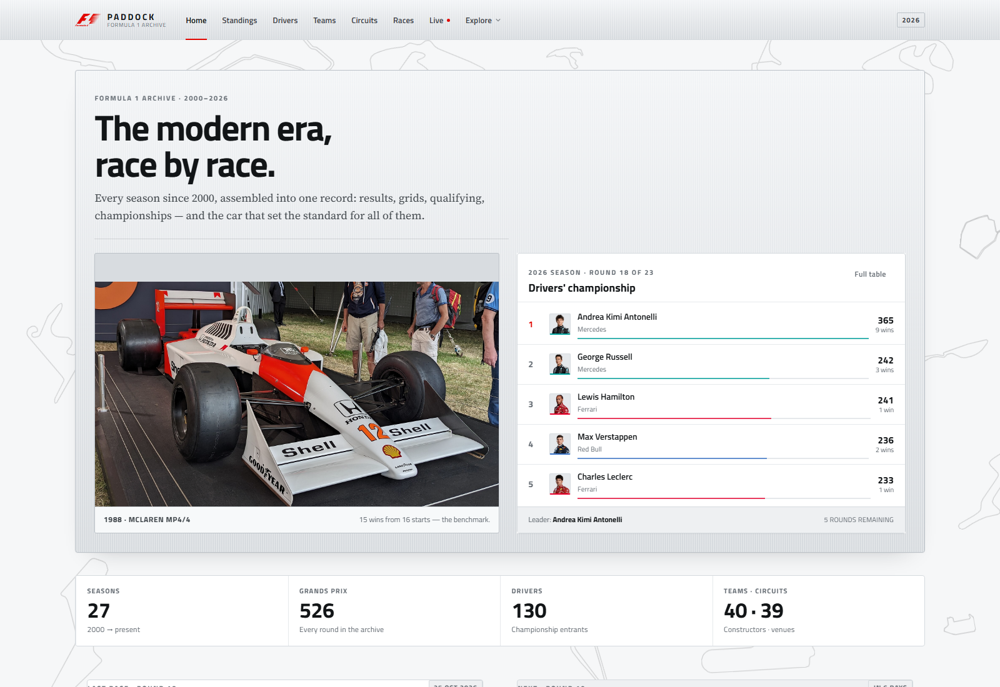
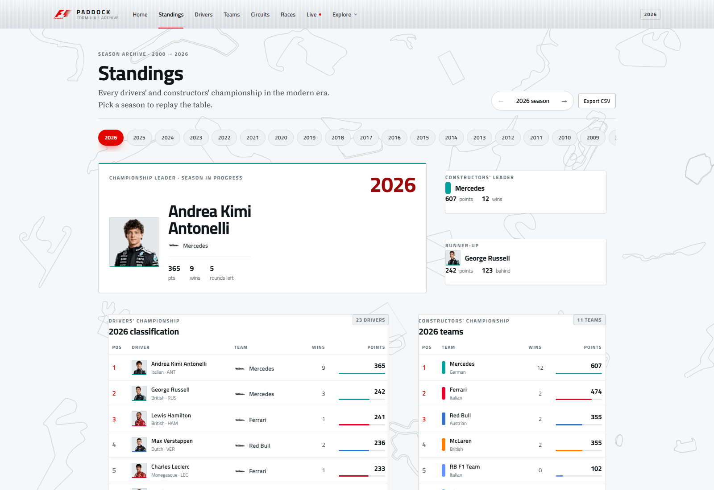
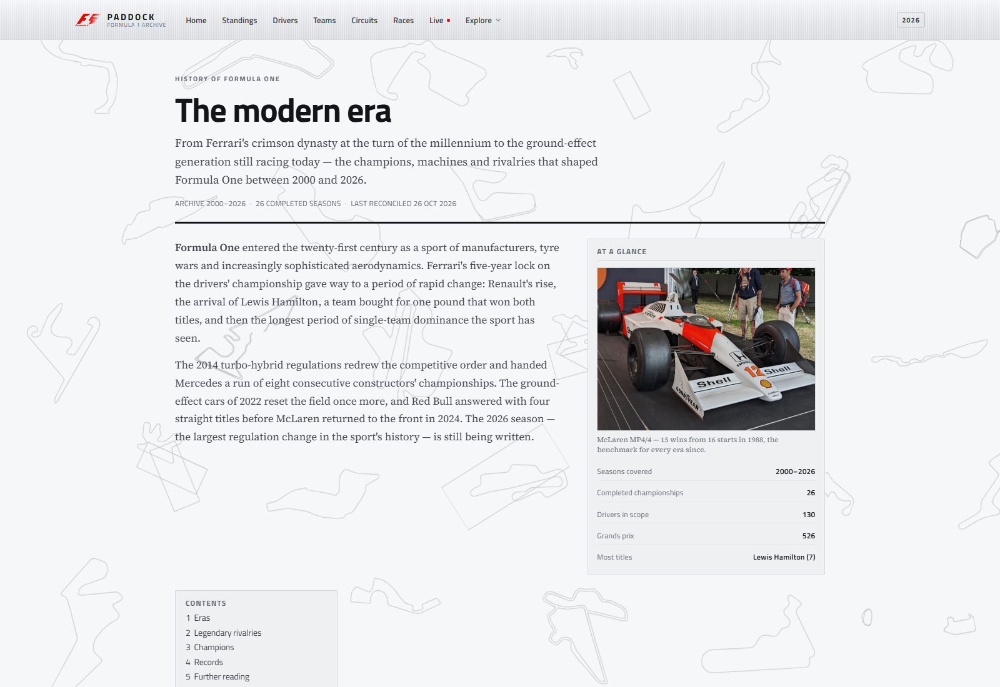
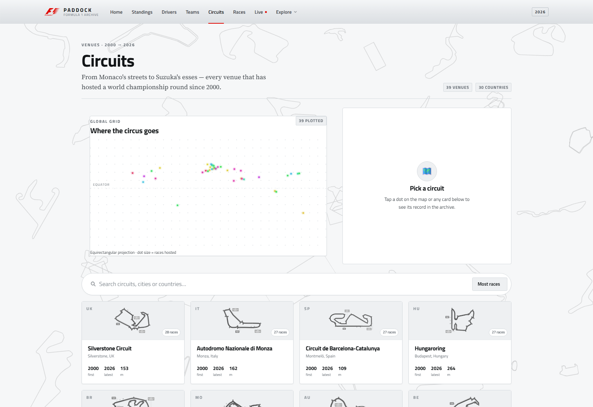
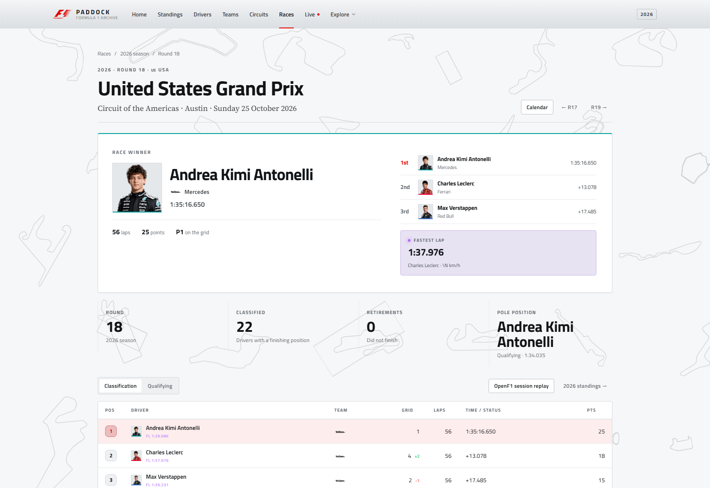
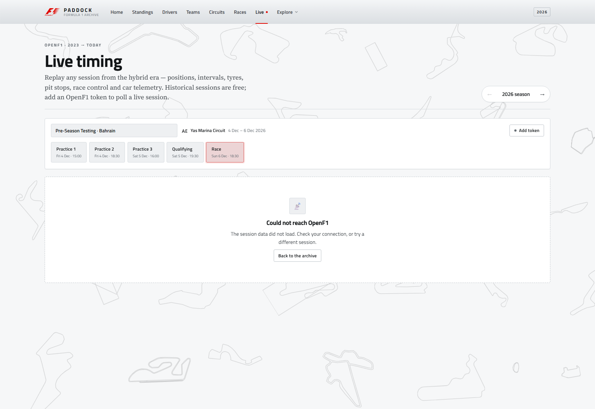

# Paddock — Formula 1 archive

**Name:** Jugal Patel · Krish Patel · Paavan Sharma
**Enr.No:** 24162581032 · 24162581017 · 24162581052
**Subject:** FET

A single-page Formula 1 archive covering every season from **2000 to the current season**, reconciled to **26 October 2026**. The browser ships the complete 2000–2026 dataset for instant, offline-friendly stats, then hands over to **OpenF1** for 2023-onward sessions, live timing, race control, weather and car telemetry.

The interface is a **brushed-silver editorial** system: matte metal surfaces, hairline rules, one red accent, Titillium Web for UI and Source Serif 4 for long-form history. It is deliberately not a dark, glassy dashboard. Thirty distinct circuit outlines, drawn in black ink at a uniform 20%, cover the background edge to edge — no corner pile, no vignette — and the home screen pairs the McLaren MP4/4 with the live 2026 championship table.

---

## Table of contents

- [What is in the app](#what-is-in-the-app)
- [Screens](#screens)
- [Screens and routes](#screens-and-routes)
- [Data sources](#data-sources)
- [Tech stack](#tech-stack)
- [Project structure](#project-structure)
- [Getting started](#getting-started)
- [Scripts](#scripts)
- [OpenF1 live timing and tokens](#openf1-live-timing-and-tokens)
- [Data pipeline](#data-pipeline)
- [Design system](#design-system)
- [Imagery and licensing](#imagery-and-licensing)
- [Performance and accessibility](#performance-and-accessibility)
- [Production build](#production-build)
- [Optional legacy backend](#optional-legacy-backend)
- [Limitations and next steps](#limitations-and-next-steps)
- [License](#license)

---

## What is in the app

- **Modern-era scope.** Only 2000-onward drivers, teams, circuits, races and championships are bundled. Pre-2000 personalities and rivalries are gone from the UI and the shipped CSVs.
- **Eleven screens**, covering the home page, standings, drivers, teams, circuits, races, race detail, live timing, history, rivalry and image credits.
- **The archive runs to the current season.** 2000–2025 are complete; 2026 is reconciled through round 18 of 23 (26 October 2026). In-progress seasons show a **leader**, never a fabricated champion.
- **Championship context everywhere.** Driver and team profiles show career totals, title years, season history and team-mates, all computed from archive rows rather than hard-coded.
- **Race detail pages.** Podium, fastest lap, grid gains, full classification, qualifying (Q1/Q2/Q3) and circuit context for all 526 archived races.
- **Head-to-head rivalry engine.** Any two drivers can be compared by career totals, points trajectory and shared-season championship positions.
- **Wikipedia-style history.** Five eras, legendary rivalries, a champions table and computed record holders in a single long-form article. The old `/timeline` route now redirects to `/history`.
- **OpenF1 live timing.** Session replay for 2023-onward, timing tower with gaps/intervals/tyres/pit stops, weather, race-control feed and per-lap speed/gear/DRS telemetry.
- **Real imagery.** Team logos, 39 circuit maps and 28 driver portraits are bundled locally. Historic teams without a licensable mark render a typographic crest rather than a broken image.
- **Attribution built in.** Every image is listed with its source and licence on `/credits`, alongside a trademark notice.

---

## Screens

| Home | Standings |
|---|---|
|  |  |

| History | Circuits |
|---|---|
|  |  |

| Race detail | Live timing |
|---|---|
|  |  |

---

## Screens and routes

| Route | Screen | Highlights |
|---|---|---|
| `/` | Home | Brushed hero with the McLaren MP4/4, 2026 top-five board, archive totals, latest and next race, 2025 champion feature |
| `/standings?year=2026` | Season standings | Drivers' and constructors' tables, champion/leader card, points gap, season switcher |
| `/drivers` | Drivers | Searchable, sortable grid; profile dialog with career totals, titles, seasons and teams |
| `/constructors` | Teams | Team grid with real logos or typographic crests, title years, driver line-ups and career totals |
| `/circuits` | Circuits | Searchable circuit library with a world map, circuit-layout images and a detail panel |
| `/races?year=2026` | Races | Season calendar, winners, podiums; year switcher |
| `/races/202618` | Race detail | Winner hero, podium, fastest lap, classification, qualifying tabs, previous/next round, circuit and season context |
| `/live?year=2026` | Live timing | OpenF1 meeting/session pickers, timing tower, weather, race control, lap telemetry, optional token |
| `/history` | History | Wikipedia-style article: lead, infobox, five eras, four rivalries, champions table and records |
| `/rivalry?d1=1&d2=830` | Rivalry engine | Two-driver picker, career totals, points chart, season-by-season table, head-to-head score |
| `/credits` | Credits | Generated list of every image, its source and licence, plus a trademark notice |

All screens are lazy-loaded except Home and share one flat silver component library. The layout responds down to phone widths.

---

## Data sources

### Bundled archive (2000–2026)

The frontend reads CSV files from `frontend/src/assets/archive/` with PapaParse. The pruned set is about **1.3 MB** and contains:

| File | Contents |
|---|---|
| `drivers.csv` | 130 drivers |
| `constructors.csv` | 40 teams |
| `circuits.csv` | 39 circuits |
| `races.csv` | 526 races across 27 seasons |
| `results.csv` | 10,954 race results |
| `qualifying.csv` | 9,968 qualifying rows |
| `season_standings.csv` | Final or current drivers' standings per season |
| `season_constructor_standings.csv` | Final or current constructors' standings per season |
| `status.csv` | Result status labels |
| `meta.json` | Generated timestamp, year range, complete seasons, current season and row counts |

`frontend/src/app/core/services/csv-data.service.ts` indexes these files once, then derives careers, championships, circuit histories, standings, race details, season summaries and rivalry data. Derived values are cached with `shareReplay`.

The first 25 seasons come from the Ergast dump. **2025 and 2026 were appended from Jolpica** by `scripts/sync-current-season.mjs`, including sprint-aware results, qualifying, standings and the new Audi, Cadillac and Madring entries.

### OpenF1 (2023 → present)

`frontend/src/app/core/services/openf1.service.ts` wraps the public API:

- `https://api.openf1.org/v1` — sessions, meetings, drivers, positions, intervals, laps, stints, pit stops, weather, race control, car data.
- Free tier: historical sessions, no key required.
- Rate limit: 3 requests/second. The client uses a token bucket (burst 3, refill about every 340 ms) plus an in-memory response cache.
- Telemetry is requested only for one driver and one lap at a time, using date-window filters. Whole-session `car_data` is never downloaded.

---

## Tech stack

| Layer | Technology |
|---|---|
| Framework | Angular 21.2, standalone components, signals, new control flow |
| UI | Angular Material 21 + CDK, custom SCSS design system |
| Data | PapaParse / ngx-papaparse, RxJS, Jolpica + OpenF1 REST APIs |
| Charts | Hand-built SVG spark chart and telemetry trace (no charting dependency) |
| Typography | Titillium Web (UI) and Source Serif 4 (article body), both self-described in `index.html` |
| Imagery | Locally bundled logos, circuit maps, portraits and archive photography |
| Build | Angular CLI 21 / esbuild, SCSS |
| Optional backend | Node.js, Express, Mongoose, MongoDB (legacy REST API, not required by the UI) |

---

## Project structure

```text
f1/
├── frontend/
│   ├── angular.json                 # build + budgets
│   └── src/
│       ├── index.html
│       ├── styles.scss              # global silver surface/button/table system
│       ├── styles/_tokens.scss      # colour, type, radius, elevation, motion tokens
│       └── app/
│           ├── app.ts               # shell: floating maps, navbar, router outlet, footer
│           ├── app.config.ts        # router, HTTP, animations, Material dialog
│           ├── app.routes.ts        # 11 lazy routes + /timeline redirect
│           ├── components/navbar/   # brushed navbar + mobile sheet
│           ├── core/
│           │   ├── config/          # data scope, team colours, asset + outline manifests
│           │   ├── models/          # archive + OpenF1 types
│           │   ├── services/        # CSVDataService, OpenF1Service
│           │   └── utils/           # formatting, countries, flags
│           ├── features/
│           │   └── rivalry/         # head-to-head engine
│           ├── pages/               # home, standings, drivers, constructors,
│           │                        # circuits, races, race-detail, live,
│           │                        # history, credits
│           └── shared/components/   # panel, page header, stat tile, avatar,
│                                    # team badge, track background, charts, skeletons
├── scripts/
│   ├── prune-archive.mjs            # rebuilds the 2000–2024 base CSVs
│   ├── sync-current-season.mjs      # appends 2025–2026 from Jolpica
│   ├── fetch-assets.mjs             # downloads logos/maps/photos + manifest
│   ├── extract-circuit-outlines.mjs # builds the floating-map outlines
│   ├── build-docs.py                # README.md → README.docx
│   └── build-deck.py                # builds the 15-slide presentation
├── archive/                         # full source dataset for the backend
├── backend/                         # optional Express + MongoDB API
├── docs/screenshots/                # app screenshots used in the docs/deck
├── README.md / README.docx / README.pdf
└── f1-presentation.pptx / f1-presentation.pdf
```

---

## Getting started

### Requirements

- Node.js 20+ (Node 24 tested)
- npm 10+
- A modern browser
- Python 3 with `python-docx` and `python-pptx` — only needed to rebuild the report and deck

No database or API key is needed to run the app.

### Frontend

```bash
cd frontend
npm install
npm start
```

Open `http://localhost:4200`. The dev server serves the archive CSVs and local images from `src/assets`.

### Production preview

```bash
cd frontend
npm run build
npx http-server dist/frontend/browser -p 8080 -c-1
```

Any static host works; configure an SPA fallback so deep links such as `/races/202618` resolve to `index.html`.

### Root convenience scripts

```bash
npm run frontend     # Angular dev server
npm run build        # production build
npm run data:prune   # rebuild the 2000–2024 base archive
npm run data:sync    # append 2025–2026 from Jolpica
npm run data:build   # prune, then sync (full archive refresh)
npm run assets:fetch # refresh logos, circuit maps, photos + manifest
npm run outlines:build # regenerate the circuit-outline set
npm run docs:build   # rebuild README.docx (Python + python-docx)
npm run deck:build   # rebuild the presentation (Python + python-pptx)
```

---

## Scripts

| Command | What it does |
|---|---|
| `node scripts/prune-archive.mjs` | Reads the full `archive/`, keeps rows from 2000 onward, rebuilds season standings, writes `meta.json`, and reports file sizes. Existing untouched archive files are never deleted from the source folder. |
| `node scripts/sync-current-season.mjs` | Fetches 2025–2026 seasons, results, qualifying and standings from Jolpica (paginating at 100 rows), synthesises race IDs and rewrites `meta.json`. Must run after the prune. |
| `node scripts/fetch-assets.mjs` | Downloads team logos, official circuit maps, OpenF1 driver headshots and Wikimedia archive photos; writes `asset-manifest.ts` with the files that actually exist and their credits. Skips existing files and backs off on HTTP 429. |
| `node scripts/extract-circuit-outlines.mjs` | Traces circuit map images into the stroke-only SVG paths used by the floating background layer. |
| `python scripts/build-docs.py` | Renders `README.md` into a styled `README.docx` with a cover, credits page, contents and screenshots. Requires `python-docx`. |
| `python scripts/build-deck.py` | Builds the 15-slide presentation as `f1-presentation.pptx`. Requires `python-pptx`. |
| `npm run build` (root) | Runs the production Angular build. |
| `npm run start` (root) | Starts the optional legacy Express server. |

---

## OpenF1 live timing and tokens

The `/live` page is a full session replay for historical data and an optional live poller for current sessions.

1. Pick a season, meeting and session. The selection is mirrored into the URL (`?year=…&session=…`) with `replaceUrl`, so links are shareable and the back button does not loop.
2. The timing tower combines positions, intervals, laps, stints, pit stops, weather, race control and the final classification. Missing fields render as dashes rather than breaking the table.
3. Choose a driver and lap to fetch a windowed telemetry trace (speed, gear, DRS, top/average speed, gear changes).
4. Real-time polling is **off by default**. Add an OpenF1 bearer token in the token panel to enable 15-second refresh. The token is stored in `localStorage` under `paddock.openf1.token`, sent only to `api.openf1.org`, and never committed.
5. `paddock.openf1.polling` remembers whether polling was left enabled.

The free tier covers historical sessions; true real-time access requires a paid OpenF1 subscription. Without a token the page remains a fully functional replay.

---

## Data pipeline

```text
Ergast-style archive (1950–2024)
        │
        ├── scripts/prune-archive.mjs
        │       ├── keep 2000–2024 rows
        │       ├── rebuild season standings from results
        │       └── write frontend/src/assets/archive/*
        │
Jolpica (2025 → 26 Oct 2026)
        │
        └── scripts/sync-current-season.mjs
                ├── append races, results, qualifying, standings
                ├── paginate at 100 rows per request
                ├── synthesise race IDs (year * 100 + round)
                └── update meta.json (completeYears, currentYear)

        └── frontend CSVDataService
                ├── index rows once
                ├── derive careers / champions / rivalries
                ├── resolve complete vs in-progress seasons
                └── shareReplay caches

OpenF1 (2023 → today)
        └── OpenF1Service
                ├── token bucket + response cache
                ├── session replay board
                └── windowed per-lap telemetry
```

To change the scope, edit `DATA_START_YEAR`, `ARCHIVE_END_YEAR` and `OPENF1_START_YEAR` in `frontend/src/app/core/config/data.config.ts`, then rerun `npm run data:build`.

---

## Design system

- **One theme, no toggle.** Silver is the only surface language. There is no dark mode, no glass, no glow and no gradient wash.
- **Tokens:** `styles/_tokens.scss` defines the silver scale, ink scale, one red accent (`#e10600`), 2–4 px radii and one soft shadow. Components never hard-code surface colours.
- **Surfaces:** every page uses the same `.panel` primitive — flat matte silver, hairline border, tiny radius. Brushed metal is reserved for the home hero plate and the navbar.
- **Typography:** Titillium Web for UI and headlines, Source Serif 4 for article body, tabular numerals for timing and points.
- **Red as a signal:** the F1 mark, the active nav rule, P1 rows and one primary action per view. Team colours appear only in data bars, badges and 2 px rules — never as backgrounds.
- **Background:** `TrackBackgroundComponent` floats thirty distinct, stroke-only circuit outlines in black ink at a uniform 20%, one of every generated circuit. They sit on a loose 6×5 staggered field that spans the full viewport, with alternating rows offset so no columns line up; sizes stay between 125 and 195 px and rotations between −35° and +35°. There is no corner mask, so the top-left carries the same weight as the bottom-right. Each track drifts 5–9 px and rocks 2–4° on its own 40–80 s loop; the field rebuilds to twenty shapes in five columns at 1400 px and ten in two columns at 760 px, and stops animating under `prefers-reduced-motion`.
- **Motion:** short eased entrances and a restrained live indicator; all motion respects `prefers-reduced-motion`.
- **Imagery:** `DriverAvatar` and `TeamBadge` read the generated manifest, lazy-load images and fall back to monograms or typographic crests.

---

## Imagery and licensing

`scripts/fetch-assets.mjs` builds `frontend/src/app/core/config/asset-manifest.ts`, which lists only the files that exist on disk. Components consult it before requesting an image, so a missing asset never produces a broken image.

| Set | Count | Source | Fallback |
|---|---|---|---|
| Team logos | 35 of 40 | Formula 1 media CDN | Typographic crest |
| Circuit maps | 39 of 39 | Formula 1 media CDN | Country flag |
| Driver portraits | 28 | OpenF1 | Monogram |
| Archive photos | 9 | Wikimedia Commons (CC/PD) | Caption only |
| F1 mark | 1 | Formula 1 | — |

The five teams without a licensable mark are MF1, Spyker MF1, Jaguar, Lotus Racing and Marussia. The 2026 grid includes the new Audi and Cadillac entries.

All sources and licences are listed in-app on `/credits`. Formula 1, F1, the F1 logo, team marks and circuit names are trademarks of Formula One Licensing B.V., the FIA and the respective teams; they appear for identification and commentary only. This is an unofficial, non-commercial student project.

---

## Performance and accessibility

- Route-level code splitting; the production initial bundle is about **580 kB raw / 154 kB transferred**.
- Archive data is fetched once and indexed; no per-page CSV downloads.
- OpenF1 cache prevents duplicate calls; the token bucket keeps the app under the 3 req/s limit.
- Semantic headings, tables with captions, labelled controls, visible focus, keyboard-operable navigation, `aria-selected` on tabs and an `sr-only` utility.
- Silver-on-ink text meets readable contrast; reduced motion and reduced transparency are handled in CSS.

---

## Production build

```bash
cd frontend
npm run build
```

Output: `frontend/dist/frontend/browser/`.

Current build characteristics:

- Initial: ~580 kB raw, ~154 kB transferred
- Lazy chunks: under 45 kB each (live timing is the largest)
- Budgets in `angular.json`: 1.5 MB warning / 2.5 MB error initial; 24 kB warning / 40 kB error per component style

Deploy the `browser` folder to any static host (Netlify, Vercel, GitHub Pages, S3, Nginx) with an SPA fallback to `index.html`.

---

## Optional legacy backend

The repository still contains the original Express + MongoDB API (`backend/`) and the full untrimmed dataset (`archive/`). The redesigned frontend does **not** call it at runtime; it is kept for reference and for anyone who wants a server-side API.

```bash
npm install
cd backend && npm install
npm run import   # requires MongoDB on localhost:27017
npm start        # http://localhost:3000
```

Endpoints include `/api/health`, `/api/drivers`, `/api/races`, `/api/results/:raceId`, `/api/latest-results` and `/api/standings/:year`.

---

## Limitations and next steps

- **2026 is in progress.** 18 of 23 rounds are complete as of 26 October 2026. The app labels the current leader as a leader and lists no 2026 champion.
- The 2026 calendar has unusual entries: Sakhir and Jeddah were cancelled, Sepang hosts the Bahrain Grand Prix in Malaysia, and Madrid uses the `madring` circuit reference.
- Driver portraits are only available for drivers OpenF1 lists from 2023 onward; earlier drivers intentionally use monograms. Arvid Lindblad has no portrait yet.
- True real-time polling requires an OpenF1 paid token.
- Possible extensions: sprint results in the archive, saved favourite drivers, deeper stint/tyre analytics and a server-side cache for OpenF1.

---

## License

Educational project for the FET subject. Formula 1 data belongs to its respective owners; OpenF1 is used under its public API terms.

---

**Built with Angular, Material 3, a lot of SCSS, and an unreasonable amount of Formula 1 data.**
